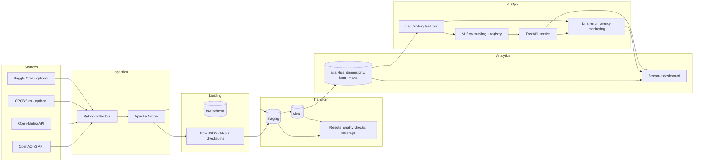

<div align="center">

# 🌫️ AQI Data Engineering & MLOps

**An end-to-end pipeline that collects Indian air-quality and weather data, builds a layered PostgreSQL warehouse, and trains, serves and monitors next-day AQI models.**


[Overview](#-overview) · [Architecture](#%EF%B8%8F-architecture) · [Quick start](#-quick-start) · [Results](#-results-and-honest-limitations) · [Project structure](#-project-structure) · [Documentation](#-documentation)

</div>

---

## 📌 Overview

This project is a data-engineering and MLOps case study built around **air quality in six Indian cities** (Delhi, Mumbai, Kolkata, Chennai, Bengaluru and Ahmedabad). It is split into two independently startable stages:

| Stage | Focus | What it delivers |
|---|---|---|
| **A: Data engineering** | Ingestion → warehouse → analytics | OpenAQ and Open-Meteo collectors, raw landing, Airflow ETL, data-quality gates, a layered PostgreSQL warehouse and a Streamlit dashboard |
| **B: MLOps extension** | Features → models → serving → monitoring | Lag/rolling feature store, MLflow tracking and registry, Dockerized FastAPI inference, prediction logging, drift and performance monitoring |

The prediction targets are the **next calendar day's city-level mean AQI** (regression) and **AQI category** (classification).

### ✨ Highlights

- **Reproducible and replayable:** every run has a pipeline UUID, and any layer can be rebuilt from the one before it.
- **Quality as a gate:** range, null, duplicate and coverage checks with a configurable failure threshold.
- **Layered warehouse:** `raw → staging → clean → analytics`, plus `ops` and `monitoring` schemas for lineage and telemetry.
- **Indian AQI methodology:** configurable CPCB breakpoints and a minimum of three valid sub-indices including PM2.5 or PM10.
- **Full model lifecycle:** MLflow tracking and registry, a FastAPI service, and drift and performance monitoring.
- **One-command stack:** Docker Compose profiles for Stage A and Stage B.

### 📈 At a glance

| | |
|---|---|
| **Scale** | 3.25M raw OpenAQ records → 526K clean hourly observations → 85.5K analytics rows across 143 stations in 6 cities |
| **Quality** | 2,005,745 rows checked; 472 rejected (0.0235% vs a 20% gate): **PASS**; every rejection stored with its rule and reason |
| **Pipeline** | 7 Airflow DAGs (daily ETL, weekly training, daily monitoring), idempotent and replayable |
| **MLOps** | MLflow tracking and registry, FastAPI service in Docker, PSI/KS drift monitoring, prediction ledger with later ground-truth matching |
| **Engineering** | 111 automated tests passing; fully containerized, one-command start |

### 🧠 Engineering decisions worth noting

- **Raw data is never thrown away.** Payloads are landed with checksums and relational upserts use natural keys, so any layer can be replayed from the one before it.
- **Time is handled explicitly.** Everything is keyed on UTC hour, India-local time is kept for interpretation only, and unit conversions are never guessed (CO is held in mg/m³).
- **No silent data invention.** Missing periods are not synthesized, and CO/O₃ 8-hour maxima use complete windows only.
- **Leakage-safe modeling.** Lag/rolling features use the past only, the split is chronological, and imputation/scaling are fitted on training rows only.
- **Guarded promotion.** A new regressor is promoted only if its MAE beats the Production model; v2 failed that test and was archived.
- **Honest operations.** Test traffic is separated from production telemetry after it distorted early alerts, and failed Airflow runs stay in the history.

---

## 🏗️ Architecture



### Warehouse layers

| Layer | Purpose | Examples |
|---|---|---|
| `raw` | Source records exactly as extracted, with run lineage | `raw.openaq_measurements`, `raw.open_meteo_weather` |
| `staging` | Typed, normalized records: canonical station and pollutant, standard units, UTC and IST timestamps | `staging.measurements`, `staging.weather` |
| `clean` | Validated, deduplicated winners after range checks and source priority | `clean.measurements_hourly`, `clean.daily_averages` |
| `analytics` | Dimensions, station-hour fact, AQI and gold marts, feature store, predictions | `analytics.fact_station_hourly`, `analytics.mart_city_daily_aqi`, `analytics.features_daily`, `analytics.predictions` |
| `ops` / `monitoring` | Run, ingestion, rejects, data-quality, coverage, API, drift and alert telemetry | `ops.pipeline_run`, `ops.dq_results`, `monitoring.prediction_log` |

### Airflow DAGs

| DAG | Schedule | Purpose |
|---|---|---|
| `aqi_etl_pipeline` | `@daily` | Master ETL: `make_run_id` → `run_pipeline` → `verify_source_coverage` |
| `aqi_ingest_openaq`, `aqi_ingest_open_meteo` | manual | Single-source ingestion |
| `aqi_ingest_cpcb`, `aqi_ingest_kaggle` | manual | Optional file-based adapters |
| `aqi_training_pipeline` | `@weekly` | Features, training, MLflow tracking and registration |
| `aqi_monitoring` | `@daily` | Drift, data quality, forecast error and API health; alerts only (retraining stays an operator decision) |

---

## 🧰 Tech stack

| Area | Tools |
|---|---|
| Language and data | Python 3.11+, pandas, SQLAlchemy, requests |
| Orchestration | Apache Airflow (separate webserver and scheduler) |
| Storage | PostgreSQL 16 (warehouse, Airflow metadata, MLflow backend), pgAdmin |
| Analytics UI | Streamlit |
| Modeling | scikit-learn (GradientBoostingRegressor and GradientBoostingClassifier with median imputer and RobustScaler) |
| MLOps | MLflow 3.2.0 (tracking and model registry), FastAPI + Uvicorn |
| Runtime | Docker Compose with `stagea` and `mlops` profiles and persistent volumes |
| Testing | pytest |

---

## 🚀 Quick start

### Prerequisites

- Docker Desktop (Docker Engine running) with Docker Compose v2
- A free **OpenAQ API key** for live pollutant ingestion ([docs.openaq.org](https://docs.openaq.org/))
- Optional: Kaggle credentials, only if you fetch the Kaggle dataset through its API
- Optional: GNU Make (equivalent Compose commands are shown below)

> ⚠️ Never commit `.env`, API keys, passwords or datasets with unclear redistribution terms. Start from `.env.example` and set private values locally.

### 1. Configure

```bash
cp .env.example .env      # PowerShell: Copy-Item .env.example .env
# edit .env: set your OpenAQ API key and unique local passwords
```

### 2. Start the stack

```bash
# Stage A: Postgres, Airflow, Streamlit, pgAdmin
docker compose --profile stagea up -d --build

# Stage A + Stage B: adds MLflow and the FastAPI service
docker compose --profile stagea --profile mlops up -d --build
```

### 3. Open the services

| Service | URL |
|---|---|
| Airflow | http://localhost:8082 |
| Streamlit dashboard | http://localhost:8501 |
| pgAdmin | http://localhost:5050 |
| MLflow (Stage B) | http://localhost:5000 |
| FastAPI docs (Stage B) | http://localhost:8000/docs |

Credentials come from your `.env`. Do not reuse default credentials outside a disposable local demo.

### 4. Run the pipeline

1. In Airflow, trigger **`aqi_etl_pipeline`**. A manual run can take `start_date` and `end_date` in the DAG run configuration.
2. Verify source coverage for a run:

   ```bash
   docker compose --profile stagea run --rm airflow-webserver \
     python /opt/airflow/scripts/verify_sources.py --run-id <PIPELINE_RUN_UUID> --strict
   ```

3. Once enough daily history exists, trigger **`aqi_training_pipeline`**, then let **`aqi_monitoring`** run daily.
4. Request a prediction:

   ```bash
   curl -X POST http://localhost:8000/predict \
     -H "Content-Type: application/json" \
     -d '{"city_id": "delhi", "as_of_date": "2026-10-14"}'
   ```

   The API predicts the **following day**; the as-of date must have stored or computable features.

### Useful Make targets

```bash
make up-all     # start everything        make test-all   # run the full test suite
make train      # trigger training        make serve      # check API + sample prediction
make monitor    # trigger monitoring      make down       # stop (data preserved)
make reset      # ⚠️ destroys all data volumes
```

### Handy commands

```bash
docker compose --profile stagea --profile mlops ps
docker compose logs --tail 200 airflow-scheduler
docker compose exec -T postgres sh -c 'psql -U "$POSTGRES_USER" -d "$AQI_DB_NAME"'
```

---

## 🔌 API reference

| Endpoint | Purpose |
|---|---|
| `GET /health` | Liveness and which model families are loaded |
| `GET /ready` | Readiness: the Production AQI regressor is loadable |
| `GET /cities` | Configured city IDs and names |
| `POST /predict` | Next-day AQI prediction for a `city_id` and `as_of_date` |
| `GET /predictions/{city_id}` | Recent prediction-ledger entries |
| `POST /reload` | Clears cached models (requires the configured reload token) |

---

## 📊 Results and honest limitations

Figures come from the documented verification run (see [`docs/EXECUTION_EVIDENCE.md`](docs/EXECUTION_EVIDENCE.md)); pipeline numbers are in [At a glance](#-at-a-glance).

**Models** (chronological holdout)

| Task | Metric | Result |
|---|---|---|
| AQI regression | MAE / RMSE / R² | 23.30 / 43.68 / −0.025 |
| AQI classification | Macro-F1 / accuracy | 0.361 / 0.703 |

> **Context.** The goal of Stage B is a trustworthy MLOps workflow, not a production forecaster. Only 182 next-day labels had matured, R² is slightly negative, and accuracy is inflated by the dominant category, so the metrics show that training, tracking, registry, serving and monitoring work end to end, not that the models generalize. The promotion guard did its job: the weaker v2 regressor was archived and v1 stays in Production.

**Known limitations**

- Live-source history is short and uneven (about 30 days); city comparisons are descriptive.
- The checked-in **CPCB and Kaggle CSVs are tiny smoke-test fixtures**, not historical datasets. OpenAQ ingestion never depends on them.
- The classifier is registered but not promoted, so the API derives the category from AQI thresholds.
- The computed AQI is an analytical estimate, **not a CPCB-certified health reading**.
- Docker Compose suits a local demo; production would need TLS, authentication, secret management and backups.

**Roadmap**

- [ ] Add a versioned CPCB historical release and, where licensed, the Kaggle dataset
- [ ] Rolling-origin, city-aware evaluation with baselines and prediction intervals
- [ ] Promote the classifier after objective validation and have the API load it
- [ ] Operator-approved retraining with rollback and model cards
- [ ] Real-time ingestion and cloud deployment (managed secrets, TLS, CI/CD)

---

## 🗂️ Project structure

```text
aqi-mlops/
├── airflow/dags/            # ETL, ingestion, training and monitoring DAGs
├── config/                  # cities, pollutants, AQI breakpoints, source priority (YAML)
├── dashboard/               # Streamlit app and pages
├── data/                    # fixtures and local landing area
├── docs/                    # architecture, data sources, data dictionary, evidence
├── mlops/
│   ├── src/aqi_mlops/       # features, training, registry, serving, monitoring
│   └── tests/
├── scripts/                 # init_db, verify_sources, trigger_dag, e2e demo
├── sql/                     # ddl/ (schemas), gold/ (marts), views/
├── src/aqi_pipeline/        # collectors, landing, load, quality, transform, utils
├── tests/                   # unit and integration tests
├── docker-compose.yml
├── Makefile
└── .env.example
```

---

## 🧪 Testing

```bash
docker compose --profile stagea --profile mlops run --rm airflow-webserver \
  python -m pytest /opt/airflow_src/tests /opt/airflow_src/mlops/tests -q
```

---

## 📚 Documentation

- [Architecture and pipeline flow](docs/ARCHITECTURE.md)
- [Data sources and access instructions](docs/DATA_SOURCES.md)
- [Data dictionary and validation rules](docs/DATA_DICTIONARY.md)
- [Execution evidence](docs/EXECUTION_EVIDENCE.md)
- [Requirements crosscheck](docs/REQUIREMENTS_CROSSCHECK.md)

## 🙏 Data sources and attribution

- [OpenAQ](https://openaq.org/) v3 API: primary pollutant observations (API key required)
- [Open-Meteo](https://open-meteo.com/) Historical Weather API: hourly weather (free, non-commercial terms; attribution required)
- [CPCB CAAQMS](https://cpcb.nic.in/CAAQMS/) and the [Kaggle India AQI dataset](https://www.kaggle.com/datasets/rohanrao/air-quality-data-in-india): optional file inputs; verify licence and version before reuse

## 👩‍💻 Author

**Deepika**, Computer Science Engineering (AI & ML), CMR Institute of Technology, Bengaluru.
Built as a Data Engineering and MLOps project.
