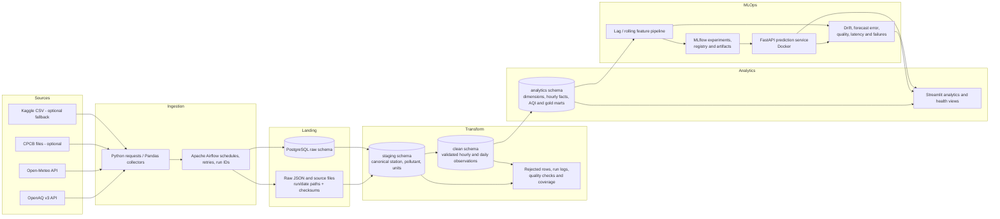

# Architecture and pipeline flow

## Layer responsibilities

1. **Source:** OpenAQ is the primary pollutant source; Open-Meteo enriches weather. CPCB and Kaggle files are optional, explicitly provenance-tracked inputs.
2. **Ingestion:** Python collectors make REST calls or parse CSV files. Airflow supplies repeatable daily/replayable execution, dependency ordering, retries, run IDs, and logs.
3. **Raw/landing:** Preserve API response pages and source files before transformation. Raw relational tables support query/replay; run metadata and file checksums support traceability.
4. **Staging:** Canonicalize station/city/pollutant identifiers, normalize units and UTC/IST timestamps, and join each row to a pipeline run. AQI-irrelevant OpenAQ parameters remain in raw but do not become pollutant facts.
5. **Clean:** Validate configured pollutant ranges, persist rejected records, deduplicate station/pollutant/hour observations by configured source priority, create hourly/daily aggregates, and calculate observation completeness.
6. **Analytics:** PostgreSQL dimensions, station-hour facts, station/city daily AQI, pollutant, hourly/monthly, weather-impact, and data-quality marts drive the dashboard.
7. **MLOps:** Reusable lag/rolling features feed time-ordered regression and classification runs. MLflow tracks artifacts and model versions. FastAPI serves the registered model; request, prediction and monitoring records support operational and delayed-outcome monitoring.

## Main orchestration

- `airflow/dags/aqi_etl_pipeline.py`: daily Stage A ingestion, transformation, DQ and source-coverage workflow; supports configured date-window replays.
- `airflow/dags/aqi_training_pipeline.py`: Stage B feature generation, regression/classification model training, MLflow registration and promotion.
- `airflow/dags/aqi_monitoring.py`: daily prediction scoring where actuals exist, feature drift, required-source freshness, ETL quality, and API health.

PostgreSQL separates the AQI warehouse, Airflow metadata, and MLflow backend databases. Compose profiles allow Stage A alone or the full Stage A + Stage B stack.
